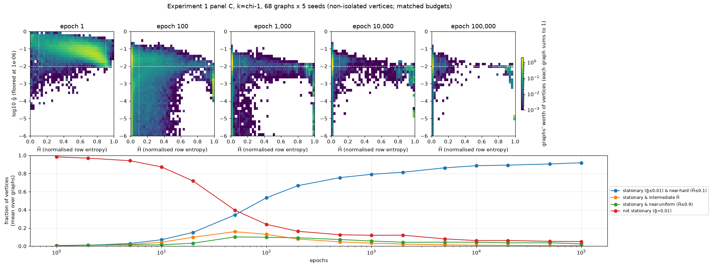
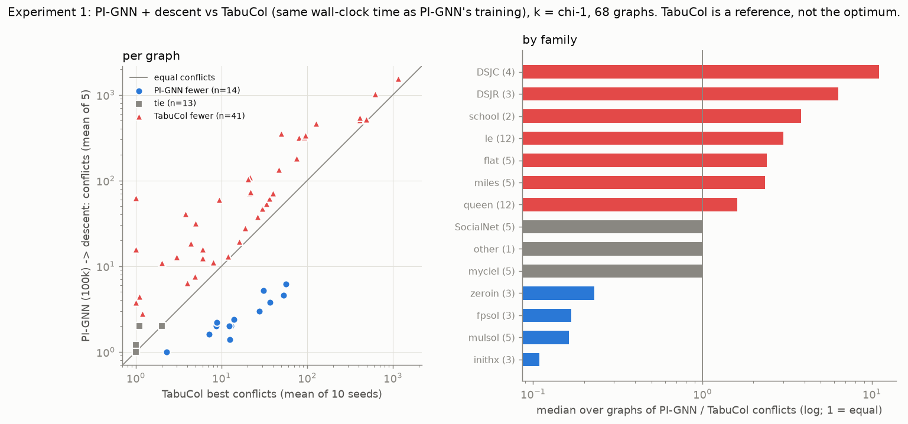

# Confidence and single vertex local optimality in physics inspired graph neural network coloring

*RQ1 of Mechanistic Dissection of PI-GNN for Graph Coloring*  
*Results available as of 11 October 2026*

## Abstract

Physics-inspired graph neural networks (PI-GNNs) optimize a continuous Potts relaxation and decode their outputs into vertex colors. We investigate whether longer training makes these decoded colorings single-flip optimal, meaning that no recoloring of one vertex strictly reduces the number of monochromatic edges. We evaluate a two-layer PI-SAGE implementation on 68 DIMACS graphs with recorded proven chromatic numbers, using five seeds per graph and the deliberately infeasible palette size $k=\chi-1$. At 100,000 epochs, 143 of 340 outputs (42.1%) are single-flip optimal; the median relative conflict reduction available from strict vertex descent decreases from 94.9% at epoch 1 to 10.5%. The behavior is strongly dependent on graph family. Training produces better starts for descent than random coloring on 62 of 68 graphs, but provides no consistent advantage over fixed-$k$ DSATUR. A selected 13-graph extension to 300,000 epochs improves mean post-descent conflicts on 12 graphs, yet only one of its 65 outputs becomes single-flip optimal. Confidence does not explain away the remaining hard improvements: the median graph has 99.7% of vertices with maximum color probability at least 0.99, and improvable vertices are often equally saturated. An exact softmax-gradient identity explains why high confidence can coexist with a useful discrete recoloring and a very small logit gradient. These findings establish partial movement toward discrete local endpoints, rather than general convergence to them, and separate confidence, local optimality, and solution quality. They complete the primary endpoint experiment in the broader project while leaving causal tests of GNN parameterization and decoder information to the remaining research questions.

## 1 Introduction

The broader project asks which components of PI-GNN account for its behavior on graph coloring: the neural parameterization and its optimization, the information in the learned soft assignment, or the discrete procedure used to obtain a hard coloring. This paper addresses the first observable endpoint question:

> **RQ1. Does PI-GNN approach a hard coloring that is single-flip optimal as training proceeds, and how do local optimality and endpoint quality depend on training budget?**

The PI-GNN formulation uses a graph neural network to produce a probability distribution over colors for each vertex and minimizes a Potts conflict objective [Schuetz et al., 2022](https://arxiv.org/abs/2202.01606). A low continuous loss or a confident probability vector is not, by itself, a certificate about the decoded coloring. Consequently, we inspect the hard assignment directly and measure the work left for a minimal local search procedure.

Three distinctions organize the analysis. First, approaching a one-hot assignment is different from reaching a one-flip local minimum. Second, local optimality is different from quality: a coloring can resist every improving single flip while a stronger search finds far fewer conflicts. Third, optimization in neural parameter space is different from optimization over all vertex probability distributions. The mathematical result below makes the third distinction precise; the experiments show why the first two matter in practice.

The contribution is a controlled endpoint analysis over training length, supported by soft-space diagnostics, classical starting-point controls, a TabuCol quality reference, and an examination of confidence at vertices that still admit improving recolorings. We do not claim that the elementary relationship between the multilinear Potts objective and local recoloring is new. Probabilistic relaxations and discrete decoding have a broader history, including [Karalias and Loukas, 2020](https://arxiv.org/abs/2006.10643). Here the question is whether the implemented neural optimizer actually reaches the endpoints suggested by the relaxation.

## 2 Objective and mathematical foundation

### 2.1 Soft and hard coloring

Let $G=(V,E)$ be a simple undirected graph with $n$ vertices, and let

$$
\Delta_k=\{p\in\mathbb R^k:p_c\geq0,\ \sum_c p_c=1\}.
$$

A soft coloring is $P=(p_v)_{v\in V}\in\Delta_k^n$. Its Potts loss is

$$
L(P)=\sum_{\{u,v\}\in E}p_u^\top p_v.
$$

For a hard coloring $c\in\{1,\ldots,k\}^n$, define

$$
C(c)=\sum_{\{u,v\}\in E}\mathbf1[c_u=c_v].
$$

If $p_v=e_{c_v}$ for every vertex, then $L(P)=C(c)$. We decode neural outputs using $c_v=\arg\max_a p_v(a)$, with the implementation's fixed argmax tie convention.

Let $M_v(a)=|\{u\in N(v):c_u=a\}|$. The largest conflict reduction available by changing vertex $v$ is

$$
\gamma_v=M_v(c_v)-\min_a M_v(a)\geq0.
$$

A coloring is **single-flip optimal** exactly when $\gamma_v=0$ for every vertex. This permits neutral moves. It is weaker than requiring every alternative recoloring to strictly increase conflicts, and much weaker than global optimality.

### 2.2 Lemma on strict local minima

**Lemma 1.** If $P^*$ is a strict local minimum of $L$ over $\Delta_k^n$, then every row $p_v^*$ is one-hot. Moreover, every change of one vertex to a different color strictly increases the corresponding hard conflict count.

**Proof.** Fix all rows except $v$ and define

$$
q_v=\sum_{u\in N(v)}p_u^*.
$$

The objective as a function of that row is affine:

$$
L(P)=B+p_v^\top q_v,
$$

where $B$ is independent of $p_v$. Suppose $p_v^*$ has positive mass on two different coordinates $a,b$. For sufficiently small $\epsilon>0$, both

$$
p_v^+=p_v^*+\epsilon(e_a-e_b),\qquad
p_v^-=p_v^*-\epsilon(e_a-e_b)
$$

remain in the simplex and produce distinct feasible matrices within any prescribed neighborhood of $P^*$. Their loss changes are

$$
L(P^+)-L(P^*)=\epsilon(q_v(a)-q_v(b)),
$$

$$
L(P^-)-L(P^*)=-\epsilon(q_v(a)-q_v(b)).
$$

If the two coordinates of $q_v$ are equal, both changes are zero, contradicting strictness. Otherwise one change is negative, contradicting local minimality. Hence every row is one-hot.

Now write $p_v^*=e_{c_v}$ and consider a different color $a$. Along the feasible segment $p_v(t)=(1-t)e_{c_v}+te_a$, the loss changes by

$$
t\,[M_v(a)-M_v(c_v)].
$$

Strict local minimality forces the bracket to be positive for every $a\ne c_v$. A full recoloring has the same positive conflict difference. $\square$

This proof follows the argument in the project's Idea.md, with the perturbations required to have distance **less than** the local-neighborhood radius, and with the subtraction signs and neighbor-sum notation corrected. Feasibility requires nonnegative coordinates; coordinates outside $\{a,b\}$ need not become strictly positive.

### 2.3 What the lemma does and does not imply

At a non-strict local minimum, each row can place positive mass only on colors minimizing $q_v(a)$. Tied minimizing colors can support a soft row. If such a minimum is hard, it is single-flip optimal; if it remains soft, coordinate optimality against soft neighbors does not automatically certify the argmax coloring against hard neighbors.

The lemma is an implication from a strict local minimum in the full probability domain. It does not establish that neural training reaches such a point. PI-GNN produces

$$
P_\theta=\operatorname{softmax}(Z_\theta),\qquad Z_\theta=f_\theta(G),
$$

and updates $\theta$, rather than allowing independent feasible changes to every row of $P$. Finite real-valued softmax logits also produce positive probabilities rather than exact simplex vertices; numerical arithmetic may nevertheless round saturated probabilities to zero or one. The experiments therefore test the endpoint connection instead of assuming it.

### 2.4 Soft coordinate gap and entropy

For any soft coloring, define

$$
q_v(a)=\sum_{u\in N(v)}p_u(a),\qquad
g_v=p_v^\top q_v-\min_a q_v(a).
$$

The nonnegative gap $g_v$ is the maximum loss reduction from replacing row $v$ by a best-response distribution while keeping all other rows fixed. For non-isolated vertices we report

$$
\widetilde g_v=\frac{g_v}{\deg(v)},\qquad
\widetilde H_v=-\frac{\sum_a p_v(a)\log p_v(a)}{\log k}.
$$

At a one-hot matrix, $g_v=\gamma_v$. However, a small **degree-normalized** gap is not the same as zero hard gain. A gain of one at degree 200 gives $\widetilde g_v=0.005$, which lies below the descriptive threshold used in this study.

The uniform assignment has $g_v=0$ and $\widetilde H_v=1$ for every non-isolated vertex. It is coordinate stationary, but on a graph containing an edge it admits a decreasing simultaneous perturbation: shift the two endpoint distributions in opposite color directions. Entropy is therefore needed alongside the gap to distinguish near-hard outputs from this symmetric stationary configuration. Neither diagnostic alone certifies a local minimum.

## 3 Experimental method

### 3.1 Graphs and palette

The main set contains 68 DIMACS graphs with `chi_proven=True` in the repository's bound table and $\chi\geq3$. Their sizes range from 11 to 1,000 vertices. The set spans queen, Mycielski, social-network, register-allocation, miles, flat, school, Leighton, DSJC, and DSJR families. The implementation expands the original plan's proposed 48-graph set to all 68 eligible graphs in this repository.

Every primary run uses $k=\chi-1$. Assuming the recorded chromatic numbers and graph files are correct, zero conflicts are impossible. This makes endpoint quality graded rather than reducing the experiment to feasible-coloring success. The chromatic numbers do not provide the optimal positive conflict count at this palette size.

### 3.2 Network and optimization

The implementation uses trainable Gaussian-initialized vertex embeddings followed by two mean-aggregation GraphSAGE layers:

$$
H^{(1)}=\operatorname{ReLU}(H^{(0)}W_{s,1}+\overline A H^{(0)}W_{n,1}+b_1),
$$

$$
Z=\operatorname{Dropout}(H^{(1)})W_{s,2}
 +\overline A\operatorname{Dropout}(H^{(1)})W_{n,2}+b_2.
$$

Here dropout denotes the same sampled hidden representation supplied to both terms, and $\overline A$ averages over neighbors, with zero rows for isolated vertices. Self and neighbor transformations are separate; no self-loop is inserted into the neighbor average. The network is trained independently on each instance with AdamW. The code leaves AdamW's other arguments at library defaults, including weight decay, so the update includes more than the gradient of the Potts loss alone.

One configuration is frozen across all test graphs: embedding dimension 85, hidden dimension 30, learning rate 0.0196158, and dropout probability 0.465589. Selection uses 13 disjoint synthetic tuning graphs and mean ranks of seed-averaged final hard conflicts across graph–palette cells. Stage 1 evaluates 43 configurations at 10,000 epochs with two seeds; stage 2 evaluates ten configurations at 50,000 epochs with three seeds. The same configuration wins both stages. The progress log records stage 2 as the top six configurations plus four new draws; this also matches its reported 780 configuration–graph–regime–seed units. A conflicting shorthand in the frozen JSON's provenance note should not be used to describe the search composition.

### 3.3 Training budgets and endpoint analysis

All 68 graphs have five runs trained for 100,000 epochs, giving 340 primary runs. Evaluation uses dropout disabled. A shared logarithmic checkpoint grid supports comparisons across graphs; additional checkpoints increase resolution on larger graphs. We report the raw state at each checkpoint, rather than the best earlier state. Training does not stop early; the original patience-style stopping event is recorded without applying it.

At each checkpoint, we count argmax conflicts, test single-flip optimality, and apply **steepest strict vertex descent**. Each move chooses a vertex with the largest positive $\gamma_v$, then a minimizing replacement color, using seeded random tie-breaking. Neutral and worsening moves are excluded. Because every move lowers an integer conflict count, descent terminates at a single-flip-optimal coloring. We record its conflicts, number of moves, runtime, and relative improvement $(C_{\rm before}-C_{\rm after})/C_{\rm before}$.

Soft diagnostics are recomputed from saved evaluation logits in float64, excluding isolated vertices. Descriptive categories use $\widetilde g\leq0.01$ for approximate coordinate stationarity, $\widetilde H\leq0.1$ for near-hardness, and $\widetilde H\geq0.9$ for near-uniformity. These categories must not be read as exact optimality certificates.

### 3.4 Controls and quality reference

We apply the same descent to random hard starts and fixed-$k$ DSATUR starts. DSATUR selects vertices by saturation and, when no conflict-free color is available, assigns a least-conflicting color within the fixed palette. Deterministic DSATUR and random starts are the two primary controls, with five seeds per graph. Additional controls randomize DSATUR ties; the vertex-tie-only variant is post hoc and has ten seeds.

TabuCol supplies a practical quality reference using ten random-start runs per graph. Each run receives the mean elapsed PI-GNN training time to 100,000 epochs for that graph. Its reported value is the best conflict count found within that run, averaged across ten seeds; PI-GNN is evaluated at the specified final checkpoint, followed by descent. Thus the comparison is a solver-quality reference with different temporal selection rules. It is elapsed-time matched, not hardware- or energy-matched: TabuCol runs on a CPU core and PI-GNN uses a GPU. Startup and initialization costs are excluded from the TabuCol search budget, and the matching budget is based on PI-GNN training time rather than a full end-to-end cost including repair.

### 3.5 Aggregation and interpretation

The graph is the unit of comparison. Seeds are averaged within graphs before aggregate comparisons; vertex diagnostics likewise give each graph equal weight. A practical tie occurs when the absolute difference is below one conflict **or** the relative difference is at most 5%. For a control with mean post-descent conflicts $C_B$, the relative difference is

$$
d_G=\frac{C_{\rm PI}-C_B}{\max(C_B,1)}.
$$

Negative values favor PI-GNN. The stored analyses report two-sided Wilcoxon signed-rank tests on nonzero graph-level relative differences. These tests use numerical differences, including small differences classified as practical ties. The two primary controls use a Bonferroni threshold of 0.025. On this heterogeneous benchmark, p-values are descriptive; seeds are not 340 independent graph samples. We report stored tests without inventing confidence intervals or claiming equivalence from a zero median effect.

## 4 Results

### 4.1 Training increases local optimality without making it universal

Table 1 reports the common 68-graph checkpoint set. Conflict means average within graphs and then across graphs. Relative descent gain is computed for each graph as the difference between its seed-mean conflicts before and after descent, divided by its seed-mean conflicts before descent (with denominator clipped below at one), and then the median is taken across graphs. It is not a ratio of the two aggregate conflict means.

| Epoch | Single-flip-optimal runs | Mean argmax conflicts | Mean conflicts after descent | Median relative descent gain |
| ---: | ---: | ---: | ---: | ---: |
| 1 | 0.0% | 1,267.3 | 132.1 | 94.9% |
| 100 | 4.4% | 5,544.6 | 129.6 | 61.5% |
| 1,000 | 24.4% | 2,908.2 | 128.8 | 28.3% |
| 10,000 | 32.1% | 2,558.9 | 123.9 | 18.9% |
| 50,000 | 37.9% | 2,063.2 | 118.6 | 10.4% |
| 100,000 | 42.1% | 1,517.3 | 114.9 | 10.5% |

At 100,000 epochs, 143/340 runs are single-flip optimal. Seventeen graphs reach this endpoint on all five seeds; 30 reach it on none. The other 21 have mixed outcomes. The median run has 2.5 improvable vertices, approximately 0.9% of its vertex count as a median run-level fraction. A small number of remaining improving vertices is sufficient to fail the whole-coloring test.

The raw conflict trajectory is markedly non-monotone. Its mean rises above the epoch-1 value before declining, and even the 100,000-epoch mean exceeds that early value. This does not imply that training generally worsens the useful starting point: large conflict counts on dense graphs strongly affect the raw mean. After descent, trained outputs beat their own epoch-1 outputs on 59 graphs, practically tie on eight, and lose on one, with a median relative change of −32.5%. Comparing only the aggregate post-descent means, 132.1 versus 114.9, would hide much of this graph-level improvement.

No evaluated endpoint reaches zero conflicts after descent, consistent with $k=\chi-1$. Training makes the coloring increasingly self-consistent under local moves, but the remaining median repair gain stays near 10% between 50,000 and 100,000 epochs. The evidence supports partial approach to one-flip endpoints over these budgets, not a claim of asymptotic convergence.

### 4.2 Endpoint behavior depends on graph family

Table 2 uses five-seed means at 100,000 epochs; percentages average the single-flip indicator within each family.

| Family | Graphs | Single-flip optimal | Mean argmax conflicts | Mean after descent |
| --- | ---: | ---: | ---: | ---: |
| queen | 12 | 85.0% | 30.50 | 30.32 |
| myciel | 5 | 84.0% | 1.40 | 1.00 |
| SocialNet | 5 | 84.0% | 1.44 | 1.20 |
| le | 12 | 38.3% | 264.58 | 260.27 |
| DSJC | 4 | 45.0% | 1,267.00 | 34.55 |
| DSJR | 3 | 33.3% | 28,793.07 | 35.93 |
| flat | 5 | 0.0% | 1,320.60 | 645.52 |
| school | 2 | 0.0% | 421.70 | 391.80 |
| miles | 5 | 24.0% | 111.28 | 2.84 |
| fpsol | 3 | 0.0% | 17.27 | 3.80 |
| inithx | 3 | 0.0% | 16.20 | 4.60 |
| mulsol | 5 | 8.0% | 8.16 | 1.68 |
| zeroin | 3 | 0.0% | 10.40 | 1.93 |
| other (games120) | 1 | 100.0% | 2.00 | 2.00 |

Queen graphs illustrate why local optimality is not a quality metric: descent changes almost nothing, yet the stronger search reference below finds fewer conflicts on every queen graph under the practical comparison rule. Conversely, the register-allocation families often have very few conflicts after repair but almost never arrive already single-flip optimal. Their low conflict totals and failure of the exact endpoint test are compatible.

The DSJR mean reveals a different failure mode. Some outputs have many conflicts before argmax repair while their soft distributions remain near a symmetric state. These should be distinguished from saturated hard assignments that are only a few discrete moves away from local optimality.

### 4.3 Soft outputs become near-hard before all hard violations disappear

By 100,000 epochs, the graph-balanced fraction of vertices classified as both near-hard and approximately coordinate stationary is 91.8%, up from 0.3% at epoch 1. Mean normalized entropy falls from 0.611 to 0.031; the median graph's mean normalized entropy is approximately 0.00033. The fraction outside the approximate-stationarity threshold falls from 98.3% to 5.0%.

These vertex-level results coexist with only 42.1% single-flip-optimal runs for two reasons. First, the hard test requires **every** vertex to have zero gain. Second, the normalized threshold can classify positive integer hard gains as approximately stationary on high-degree vertices. A high percentage of vertices in the near-hard/low-gap category therefore overstates exact hard local optimality if interpreted as a certificate.

The stationary-near-uniform category comprises 2.5% of vertices on average at 100,000 epochs, but is concentrated in DSJR, where it accounts for approximately 38%. This provides evidence of heterogeneous soft endpoint behavior rather than a single common hard-minimum explanation.

*Figure 1. Existing soft diagnostic companion figure. The relevant 68-graph endpoint comparison is at 100,000 epochs. The categories use degree-normalized gaps and descriptive thresholds; they do not certify single-flip optimality.*

### 4.4 Confidence is high even at improvable vertices

The post hoc confidence analysis evaluates 340 endpoints at 100,000 epochs and 65 extended endpoints at 300,000 epochs. Its recomputed conflicts and improvable-vertex counts agree with the endpoint logs on all 405 run–budget pairs.

For non-isolated vertices at 100,000 epochs, the median over graphs of the seed-averaged fraction with $p_{\max}\geq0.99$ is 99.66%; the corresponding fraction with $p_{\max}\geq1-10^{-6}$ is 98.45%. The median over graphs of the seed-averaged within-run median top-two logit margin is about 205.

Crucially, improvable vertices are often just as confident. Among the 51 graphs with at least one improvable endpoint vertex, the median graph's mean fraction of improvable vertices above 0.99 is 100%, and above $1-10^{-6}$ is 98.09%. The corresponding median logit margin is about 149. These summaries average only runs with an improvable vertex for the conditional statistics. They do not pool all vertices: pooled results give dense DSJR failures disproportionate weight.

There is a direct mathematical reason why such confidence can coexist with poor discrete choices. For the Potts loss,

$$
\frac{\partial L}{\partial z_{v,a}}
=p_v(a)\left[q_v(a)-p_v^\top q_v\right].
$$

Near a one-hot distribution, alternative-color probabilities are very small and the bracket for the selected color approaches zero. Thus the logit gradient can be extremely small even when moving probability toward another color would decrease the objective in probability space. With a large top-two margin, the alternative mass decays exponentially. Saved evaluation logits show this saturation pattern at many improvable vertices.

This observation is **consistent with softmax saturation as a contributor to persistent discrete errors**. It does not establish a complete causal explanation of training. The diagnostics use dropout-disabled evaluation states, whereas updates use dropout; shared GNN parameters allow other vertices' gradients to change a vertex's logits; AdamW rescales updates and applies weight decay. A tiny per-vertex logit gradient does not prove that subsequent parameter updates cannot change that vertex. Training-mode diagnostics or interventions would be needed for that stronger claim.

### 4.5 Training supplies a better start than random coloring

Table 3 compares conflicts after the same strict descent. Win/tie/loss is from PI-GNN's perspective.

| Starting-point control | Role | PI-GNN wins / ties / losses | Median relative difference | Descriptive Wilcoxon p |
| --- | --- | ---: | ---: | ---: |
| Random hard coloring | Primary | 62 / 5 / 1 | −38.7% | $5.11\times10^{-12}$ |
| Deterministic fixed-$k$ DSATUR | Primary | 16 / 28 / 24 | 0.0% | 0.00257 |
| DSATUR with the original randomized ties | Exploratory | 29 / 24 / 15 | −5.2% | 0.617 |
| PI-GNN's own epoch-1 output | Exploratory | 59 / 8 / 1 | −32.5% | $2.06\times10^{-12}$ |
| DSATUR with random vertex ties only | Post hoc | 19 / 26 / 23 | 0.0% | 0.00569 |

The random-start comparison demonstrates that training provides a useful starting point for this particular descent procedure. It does not isolate message passing: trainable vertex embeddings, neural optimization, initialization, and dropout are bundled in PI-GNN.

The DSATUR comparison gives no consistent practical PI-GNN advantage. The zero median difference and mixed wins and losses do **not** establish statistical equivalence. Indeed, its descriptive signed-rank p-value is below the primary threshold. The test and practical comparison answer different questions: the test uses ranks of nonzero relative differences, while the win/tie rule groups sufficiently small differences into practical ties. The appropriate conclusion is that the benchmark has a heterogeneous family-dependent difference, without a broad practical advantage for PI-GNN.

Randomizing vertex ties while retaining lowest-index color choices changes the quantitative DSATUR results but not that conclusion. Deterministic and vertex-randomized DSATUR practically tie on every register-allocation and miles graph. Thus the observed DSATUR advantage on those families is not explained by vertex-order tie-breaking alone.

### 4.6 Local optimality does not ensure strong solution quality

TabuCol finds fewer conflicts than PI-GNN plus descent on 41 graphs, practically ties on 13, and finds more on 14. The graph-balanced mean is 70.45 conflicts for TabuCol versus 114.86 for PI-GNN plus descent. Every saved TabuCol best coloring is single-flip optimal, and applying strict descent never changes its conflict count.

The median within-family PI-GNN/TabuCol conflict ratio is approximately 11.1 for DSJC, 6.3 for DSJR, 3.8 for school, 3.0 for le, 2.4 for flat, and 1.6 for queen. TabuCol wins on all 12 queen graphs despite the high frequency of already single-flip-optimal PI-GNN outputs there. This directly separates arrival at a local endpoint from the quality of that endpoint.

All 14 PI-GNN wins occur on register-allocation graphs. These results should not be treated as a general neural advantage: DSATUR is stronger than PI-GNN on those families, and the repository's additional diagnostics identify poor behavior of this random-start TabuCol implementation there. TabuCol is a practical reference, not an oracle or the optimal conflict count. Its initialization and implementation can themselves be limiting factors.

*Figure 2. Existing 100,000-epoch quality comparison with a random-start TabuCol reference. Elapsed search time is matched to PI-GNN training time per graph; hardware, number of seeds, and temporal selection rules differ as described in Section 3.4.*

### 4.7 Longer training does not resolve the selected difficult endpoints

Thirteen graphs are extended from 100,000 to 300,000 epochs. Selection follows the first sweep's budget-extension rule: more than 10% and at least three mean raw conflicts removed between 50,000 and 100,000 epochs, together with a single-flip-optimal fraction below 0.5 at 100,000. This is a selected follow-up, not a representative 300,000-epoch estimate for all 68 graphs. The progress log records that all 65 resumed runs preserve their earlier endpoint and trajectory records through 100,000 epochs, excluding nondeterministic descent runtime.

Table 4 is recomputed directly from `results/main/*/endpoint_trajectory.jsonl`, because the general aggregate CSVs primarily describe the common 100,000-epoch experiment.

| Graph | Raw conflicts at 100k | Raw conflicts at 300k | After descent at 100k | After descent at 300k |
| --- | ---: | ---: | ---: | ---: |
| DSJC125.9 | 40.4 | 40.6 | 15.8 | 13.8 |
| DSJC250.9 | 4,967.6 | 2,632.8 | 62.8 | 53.6 |
| DSJR500.1c | 39,210.4 | 490.8 | 40.8 | 33.0 |
| flat1000_60_0 | 2,492.4 | 2,188.6 | 1,018.6 | 980.2 |
| flat300_26_0 | 205.8 | 181.8 | 180.6 | 166.2 |
| flat300_28_0 | 163.8 | 145.8 | 134.2 | 127.6 |
| fpsol2.i.3 | 6.6 | 7.2 | 3.8 | 3.6 |
| inithx.i.1 | 24.4 | 21.6 | 3.0 | 2.4 |
| le450_25c | 122.0 | 106.2 | 109.0 | 94.4 |
| miles1500 | 526.8 | 570.2 | 3.8 | 4.8 |
| school1_nsh | 340.8 | 276.0 | 317.8 | 258.0 |
| zeroin.i.1 | 20.0 | 18.2 | 1.6 | 1.4 |
| zeroin.i.2 | 5.6 | 3.4 | 2.2 | 1.4 |

Mean repaired conflicts improve on 12/13 graphs, although raw conflicts worsen slightly on three. On this same subset, the single-flip-optimal count changes from 0/65 to only 1/65, the one success being a seed of fpsol2.i.3. Longer training can therefore improve the basin reached by descent without making the raw neural output a local minimum.

Reaggregating the saved soft diagnostics on these same 13 graphs gives a decrease in mean normalized entropy from 0.0980 to 0.0242. The near-hard/low-gap fraction rises from 77.3% to 83.1%, and the stationary-near-uniform fraction decreases from 6.78% to 0.73%. These changes accompany the large raw improvement on DSJR500.1c. However, the extension includes only that DSJR graph, so it cannot establish that all DSJR symmetric failures disappear with additional training.

The TabuCol runs remain budgeted against 100,000-epoch training. We therefore do not label comparisons with the 300,000-epoch endpoints as time-matched; a corresponding longer TabuCol reference has not been run.

## 5 Discussion

RQ1 receives a qualified answer. Longer training increases the frequency of single-flip-optimal colorings and reduces the amount left for strict descent. Yet most final outputs in the main experiment still admit an improving recoloring, and almost all selected extended runs remain non-optimal under the same elementary test. The evidence does not support treating trained PI-GNN outputs as ordinary discrete local minima by default.

The mathematical and experimental findings fit together without a contradiction. Lemma 1 says that strict probability-space minima are hard and resist every single recoloring. The experiments show hard-looking assignments that still admit improving flips. Such assignments fail the lemma's necessary endpoint property; confidence alone cannot establish that they are strict probability-space minima. Small logit gradients can additionally arise from the softmax map even when the probability-space objective has a useful descent direction.

The results also reject an overly simple account in which training contributes nothing and descent does all the useful work. Trained starts substantially improve upon random starts and epoch-1 starts under identical repair. What remains unresolved is the source of that improvement. RQ1 does not distinguish the GNN from direct optimization of vertex logits, and it does not determine whether a richer decoder can extract graph-specific information that argmax discards.

Finally, the quality references show that merely reaching a one-flip endpoint is an insufficient success criterion. Queen graphs frequently reach such endpoints, yet TabuCol consistently improves on their quality. Register-allocation graphs show the complementary problem: a reference solver can be weak on a particular family, so a PI-GNN win against that solver does not establish a strong solution. Family-level reporting and multiple reference points are essential to the mechanistic interpretation.

## 6 What this achieves in the general project plan

The general plan contains three core experiments. Their numbering differs from the question numbering: Experiment 1 addresses RQ1, Experiment 2 addresses decoding RQ3, and Experiment 3 addresses parameterization RQ2.

*Status update, 14 October 2026:* the Experiment 2 / RQ3 rows below were updated after that experiment was run ([Experiment2_Steps.md](Experiment2_Steps.md)). The rest of this paper still reports results as of 11 October.

| Planned component | Achievement supported by this repository | Status and remaining scope |
| --- | --- | --- |
| Shared experiment harness | Independent PI-SAGE implementation; saved initial states and logits; checkpointed, resumable trajectories; conflict accounting; exact single-flip checks; strict descent; graph-level aggregation | Substantial shared foundation completed. D-CE, sampling and the null-P controls were added and unit-tested for Experiment 2 (14 Oct). |
| Experiment 1 and RQ1 primary endpoint curves | 68 graphs × 5 seeds to 100k; raw conflicts and repaired conflicts across budgets; exact local-optimality test; family analysis | Primary empirical question answered for this regime and implementation. |
| RQ1 soft-space diagnostics | Joint normalized gap–entropy analysis; saved per-vertex diagnostics; post hoc confidence and logit-gradient analysis | Completed, with the explicit distinction between approximate stationarity and exact hard optimality. |
| RQ1 starting-point controls | Random and fixed-$k$ DSATUR plus identical descent; randomized DSATUR sensitivity checks | Completed. Training helps over random starts; a broad advantage over DSATUR is unsupported. |
| RQ1 solution-quality reference | 680 random-start TabuCol runs at the 100k training-time budget | Completed as a reference, with implementation and family limitations. No 300k time-matched reference. |
| Longer-budget robustness | 13 selected graphs × 5 seeds to 300k; matched-subset endpoint and soft analyses | Completed for the selected follow-up. No all-graph 300k conclusion. |
| Secondary $k=\chi$ endpoint study | Validation and tuning include feasible-palette runs | A systematic 68-graph, five-seed endpoint study of successful and failed $k=\chi$ runs is not established here. |
| Experiment 2 and RQ3 decoder information | D-CE (saturation and random order), sampling, and uniform, untrained, row-permuted and within-row color-permuted controls on the frozen 100k outputs (68 × 5), plus all Experiment 3 arms through the same decoders | Completed 14 Oct. D-CE adds little over argmax plus strict descent; trained P beats permuted and untrained P but is not distinguishable overall from uninformative P under D-CE, which is DSATUR, with a family split; decoding does not erase the differences between optimisers. |
| Experiment 3 and RQ2 GNN contribution | Initial logits and trained PI-GNN trajectories provide the paired reference | Separately tuned free logits from the exact PI-GNN initial state, random-start free logits, noise controls, and matched-step/time comparisons remain. |
| Gated mechanistic extensions | Endpoint diagnostics identify possible saturation and symmetric-state behavior | Fixed preconditioners, update alignment, and architecture interventions remain conditional on a meaningful PI-GNN/free-logit difference. |
| Secondary warm-start and mean-field studies | Saved TabuCol colorings and endpoint tools can support later work | No new complete case-study result is claimed here. |

The achieved contribution is therefore a resolved first component of the planned decomposition: we now know how the implemented PI-GNN's hard and soft endpoints evolve, how much simple repair remains, and how the resulting local minima compare with basic starts and a stronger search reference. This is a substantive RQ1 result, including informative negative findings. It does not yet settle the broader project's causal question about the contribution of message passing or the information used by sophisticated decoding.

The immediate continuation is to reuse the frozen outputs for Experiment 2 and implement the exact-same-start free-logit comparison for Experiment 3. (Experiment 2 has since been run, 14 Oct; its D-CE-on-uniform control is fixed-$k$ DSATUR, and the resulting tie with trained P is consistent with the DSATUR comparison above.) The RQ1 findings make dropout controls and separate reporting of argmax and repaired outcomes especially important. Heavy kernel or spectral analyses should retain the original plan's gate rather than being justified solely by the confidence observations.

## 7 Limitations

The results describe one frozen two-layer PI-SAGE configuration and a heterogeneous DIMACS set. They do not establish a general result for all GNN architectures, optimizers, or graph distributions. The recorded chromatic-number claims are inherited from the repository's dataset curation, rather than independently reproved in this analysis.

The experiment is finite-budget. The selected extension gives evidence that additional training does not quickly resolve the difficult endpoint violations; it does not prove that they persist indefinitely. Family samples are sometimes small, and numerical averages can be dominated by large conflict counts even when graphs receive equal weight.

Soft categories depend on thresholds and degree normalization. Confidence and gradients are measured at evaluation states. Saturation is a supported interpretation, not an experimentally isolated cause. The stored comparisons provide descriptive p-values but no uncertainty intervals; no uncomputed confidence intervals are implied by the reported percentages.

The TabuCol reference compares a within-run best against a fixed neural endpoint, uses more seeds, and matches elapsed time across different hardware. Its random initialization is weak on register-allocation graphs. Finally, the broader project remained incomplete, as of this paper, until the decoder-information and independently tuned free-logit experiments were performed; the decoder-information experiment has since been run (14 Oct, [Experiment2_Steps.md](Experiment2_Steps.md)).

## 8 Conclusion

PI-GNN becomes more nearly single-flip optimal with training, but does not reliably reach that endpoint within the tested budgets. Its learned starts are useful compared with random initialization, while their advantage over graph-aware classical starts is inconsistent. Highly confident outputs can still contain improving discrete moves, and even genuinely single-flip-optimal outputs can be substantially worse than a stronger local-search reference. RQ1 therefore establishes the need to evaluate confidence, exact local optimality, and solution quality separately. It supplies the endpoint evidence and reusable experimental foundation for the remaining decomposition of neural parameterization and decoding.

## References and evidence

1. Schuetz, M. J. A., Brubaker, J. K., Zhu, Z., and Katzgraber, H. G. (2022). [Graph Coloring with Physics-Inspired Graph Neural Networks](https://arxiv.org/abs/2202.01606). *Physical Review Research*, 4, 043131.
2. Karalias, N., and Loukas, A. (2020). [Erdos Goes Neural: an Unsupervised Learning Framework for Combinatorial Optimization on Graphs](https://arxiv.org/abs/2006.10643). NeurIPS 2020.

Project sources are the supplied *PI_GNN_Mechanistic_Plan_Final_v3.docx* and *Idea.md*. The former specifies the broader research questions and experiment sequence; the latter supplies the lemma argument and RQ1 motivation. Proposed experiments and historical results mentioned there are not counted as completed experiments in this paper.

The following repository artifacts support the reported results:

| Evidence | Repository location |
| --- | --- |
| Graph set, palette, and family metadata | [Sweep manifest](../configs/sweep_manifest.csv), [chromatic-number bounds](../data/dimacs/chi_bounds.csv) |
| Model and fixed-budget training implementation | [Model](../src/graphsml/model.py), [training](../src/graphsml/train.py), [frozen configuration](../configs/pignn_frozen.json) |
| Exact hard tests, strict descent, and soft diagnostics | [Endpoint implementation](../src/graphsml/endpoint.py), [endpoint tests](../tests/test_endpoint.py) |
| Table 1 and common-budget trajectories | [Figure summary](../results/analysis/figure1_summary.csv), [graph-level endpoints](../results/analysis/per_graph_epoch.csv), [seed-level endpoints](../results/analysis/tidy_seed_level.csv) |
| Tables 2 and 4, extension counts, and raw-record audit | [Per-run raw endpoint trajectories](../results/main/) under `<graph>_seed<seed>/endpoint_trajectory.jsonl` |
| Soft summaries and joint distributions | [Soft summary](../results/analysis/soft_summary.csv), [graph-level soft results](../results/analysis/soft_per_graph_epoch.csv), per-run `soft_diagnostics.jsonl` in [main results](../results/main/) |
| Confidence and improvable-vertex analysis | [Run summaries](../results/analysis/onehot_runs.csv), [improvable vertices](../results/analysis/onehot_improvable_vertices.csv), [analysis implementation](../scripts/onehot_vs_sfo.py) |
| Table 3 and family comparisons | [Control summary](../results/analysis/controls_summary.csv), [family controls](../results/analysis/controls_by_family.csv), [order sensitivity](../results/analysis/controls_posthoc_order.csv), [comparison rules](../scripts/analyze_controls.py) |
| TabuCol quality reference | [Graph-level results](../results/analysis/tabucol_per_graph.csv), [family results](../results/analysis/tabucol_by_family.csv), [budget implementation](../scripts/run_tabucol.py) |
| Experimental decisions, validation, and run history | [Progress log](progress_exp1.md), [implementation plan](Experiment1_Steps.md) |

For this paper's raw-record check, the main endpoint files contain exactly 340 distinct graph–seed records at 100,000 epochs and 65 at 300,000 epochs, with no duplicate graph–seed–epoch keys across the loaded trajectories. No logged descent result increases conflicts, and none reaches zero. The selected-subset soft summaries in Section 4.7 are recomputed from the corresponding 65 saved diagnostic rows at each budget, rather than inferred from the 68-graph summary.
