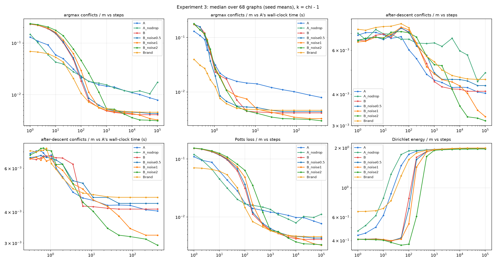

# Parameterization, noise, and local-minimum quality in physics inspired graph neural network coloring

*RQ2 of Mechanistic Dissection of PI-GNN for Graph Coloring*  
*Results available as of 14 October 2026*

## Abstract

Physics-inspired graph neural networks (PI-GNNs) optimize a continuous Potts relaxation, but it is unclear whether their graph-dependent parameterization reaches better solutions than optimizing vertex logits directly. We compare a two-layer PI-SAGE network with independently tuned free logits initialized from the network's exact initial output on 68 DIMACS graphs, using five seeds and the infeasible palette size $k=\chi-1$. At 100,000 steps, free logits produce better raw argmax colorings under the prespecified graph-level rule: 32 wins, 23 practical ties, and 13 losses. After identical strict vertex descent, the comparison reverses: PI-GNN wins on 26 graphs, ties on 25, and loses on 17, with a median relative difference of 6.0% in PI-GNN's favor. Both readings persist at matched training time. This modest repaired-output advantage is sensitive to noise: Gaussian noise added directly to free logits reverses it, with standard deviation two beating PI-GNN plus descent on 44 graphs and losing on three. A separately tuned node MLP does not reproduce PI-GNN's repaired-output advantage, while a tuned linearization of PI-GNN at initialization is worse than both PI-GNN and free logits. Free-logit initialization from the GNN is not distinguishable from a scale-matched random start under the primary rule. Output diagnostics associate dropout with extreme logit saturation, which also appears in the node MLP. The results identify a conditional advantage of the full PI-GNN training procedure over plain free logits after repair, rather than a general advantage of message passing over simpler noisy optimization.

## 1 Introduction

PI-GNN represents a soft coloring with a neural network and minimizes the expected number of monochromatic edges under independent vertex sampling. The original formulation connects graph coloring to the Potts model [Schuetz et al., 2022](https://arxiv.org/abs/2202.01606). However, the same objective can be optimized without a GNN by assigning one trainable logit vector to every vertex. The graph remains in the loss even when it is absent from the forward network. Consequently, useful solutions from PI-GNN do not by themselves establish that message passing supplies the useful component.

The companion [RQ1 paper](RQ1_Paper.md) establishes the endpoint phenomenon motivating this comparison. Training improves the starts supplied to strict vertex descent, but many highly confident PI-GNN outputs still admit improving recolorings. That study leaves open whether the neural parameterization improves optimization relative to a simpler continuous model. Here we address:

> **RQ2. Does the GNN parameterization reach better minima than directly optimizing one logit vector per vertex? If it does, can a fixed graph-dependent preconditioner reproduce the difference?**

The comparison must distinguish the quality of the optimizer's raw coloring from the quality of the discrete local minimum reached after repair. It must also distinguish graph aggregation from shared neural weights, stochastic training, and graph-dependent initialization. We therefore compare the full PI-GNN, free logits, free logits from a random start, PI-GNN without dropout, noisy free logits, a node MLP without message passing, and PI-GNN linearized at initialization.

Comparing GNN optimization with direct logits is not new. For example, [Vanderbush and Weber, 2026](https://arxiv.org/html/2601.05137v1) include a depth-zero direct-logit ablation in their coloring study. Our contribution is the controlled decomposition on structured DIMACS instances: matched initial logits, independent tuning, comparisons by steps and elapsed time, identical discrete repair, and noise and architecture controls. We study per-instance optimization, with no training across test graphs and no change of palette during a run.

The subquestions below are ordered by their importance to answering RQ2, rather than by execution date. The primary method comparison comes first, followed by the interventions that most directly change its interpretation. Initialization and trajectory diagnostics then qualify the mechanism, and family and budget analyses establish the limits of the aggregate result.

| Priority | Subquestion | Role in the argument | Results section |
| ---: | --- | --- | --- |
| 1 | Does PI-GNN beat separately tuned free logits, before and after identical repair, at matched steps and time? | Establishes whether there is an advantage to explain | 4.1 |
| 2 | Can training noise explain or reverse that advantage? | Tests a major alternative to an architectural explanation | 4.2 |
| 3 | Does removing message passing while retaining a neural parameterization reproduce PI-GNN? | Tests whether shared weights and learned embeddings suffice | 4.3 |
| 4 | Can the graph-dependent linearization at initialization reproduce PI-GNN? | Tests the fixed-preconditioning account in the main RQ2 | 4.4 |
| 5 | Does PI-GNN's initial output give free logits a useful starting point? | Checks the initialization explanation | 4.5 |
| 6 | How do saturation, movement, and edge variation differ between arms? | Describes the optimization behavior underlying the endpoints | 4.6 |
| 7 | Do family and longer-budget results support the same reading? | Checks heterogeneity and finite-budget sensitivity | 4.7 |

## 2 Objective and mathematical foundation

### 2.1 Shared relaxation and hard endpoints

For a simple undirected graph $G=(V,E)$ with $n$ vertices and $m$ edges, a soft coloring is a matrix $P\in\Delta_k^n$, where every row is a probability distribution over $k$ colors. All arms use the same clean evaluation objective,

$$
L(P)=\sum_{\{u,v\}\in E}p_u^\top p_v,
\qquad P=\operatorname{softmax}(Z),
$$

with softmax applied row-wise. Argmax decoding gives $c_v=\arg\max_a p_v(a)$, and the hard conflict count is

$$
C(c)=\sum_{\{u,v\}\in E}\mathbf 1[c_u=c_v].
$$

Let $M_v(a)$ count the neighbors of $v$ currently assigned color $a$. A coloring is **single-flip optimal** when

$$
M_v(c_v)-\min_a M_v(a)=0
\quad\text{for every }v.
$$

Our common repair procedure repeatedly performs a recoloring with the largest strictly positive conflict reduction, using seeded random tie-breaking. It permits neither neutral nor worsening moves and terminates at a single-flip-optimal coloring. We denote its conflict count by $C_{\mathrm{desc}}$. Thus $C$ measures the raw optimizer output, while $C_{\mathrm{desc}}$ measures the quality of a local endpoint reached from that output. Neither is an optimality gap.

RQ1 proves that every strict local minimum of the multilinear Potts objective over the full product of simplices is hard and resists every single-vertex recoloring. We reuse that result without repeating its proof. It does not guarantee that finite-budget softmax optimization, with neural parameters or direct logits, reaches such a minimum. In particular, the free-logit arm optimizes $Z$, not independent simplex coordinates, and its selected optimizer includes weight decay. Its observed single-flip optimality is an empirical result.

### 2.2 What parameterization changes

For PI-GNN, write the vectorized logits as $z=f_\theta(G)$ and let $J_\theta=\partial z/\partial\theta$. Under gradient flow on the Potts loss alone,

$$
\frac{dz}{dt}=-J_\theta J_\theta^\top\nabla_z L.
$$

For a finite gradient-descent step, this is a first-order approximation because the network is nonlinear in its parameters. The Jacobian couples vertices and colors, so neural training can follow different output-space directions from direct logit optimization. Adam or AdamW further introduces coordinate scaling, momentum, and, for AdamW, decoupled weight decay; their actual updates should not be identified with the simple gradient-flow equation.

The fixed-linearization arm tests

$$
z(\delta)=z_0+J_0\delta,
\qquad \delta=\theta-\theta_0,
$$

where $J_0$ is the evaluation-mode PI-GNN Jacobian at initialization and remains fixed. With plain gradient descent on $\delta$, the induced update is exactly

$$
z_{t+1}=z_t-\eta J_0J_0^\top\nabla_z L.
$$

This supplies a graph-dependent coupling without evolving nonlinear features. The selected experimental configuration uses Adam, so the trained model retains a fixed Jacobian map but has adaptive, history-dependent parameter updates. It is therefore a fixed neural linearization, not literally constant-matrix gradient descent throughout training.

## 3 Shared experimental setup

### 3.1 Graphs, seeds, and reused RQ1 components

The primary benchmark is the same 68 DIMACS graphs used in RQ1, with recorded proven chromatic numbers $\chi\geq3$, sizes from 11 to 1,000 vertices, and five seeds per graph. Every primary run uses $k=\chi-1$. Assuming the repository's chromatic numbers and graph files are correct, zero conflicts are impossible; the unknown minimum positive conflict count is not supplied by $\chi$.

We reuse PI-GNN's saved trajectories, initial weights, initial evaluation logits, and checkpoint outputs from RQ1. We also reuse the graph manifest, Potts implementation, argmax convention, exact single-flip test, strict descent, and checkpoint grid. These shared components are described in detail in [RQ1_Paper.md](RQ1_Paper.md). The RQ2 analysis compares nine arms, each with 340 common-budget outputs, for 3,060 graph–seed–arm endpoints at 100,000 steps. This count includes the reused PI-GNN arm.

### 3.2 Arms and what each comparison isolates

| Arm | Parameterization and training | Initialization | Main purpose |
| --- | --- | --- | --- |
| A | Full two-layer PI-SAGE with trainable embeddings and hidden dropout | Seeded PI-GNN initialization | Reference method |
| B | One trainable $k$-logit vector per vertex | A's exact saved evaluation logits $Z_0$ for that graph and seed | Direct optimization from the same output state |
| B-rand (`Brand`) | Same optimizer and parameterization as B | Row-centered Gaussian logits rescaled to the standard deviation of row-centered $Z_0$ | Initialization control |
| A-no-dropout (`A_nodrop`) | A with dropout set to zero; other settings retained | Same initial network and evaluation logits as A | Dropout intervention within PI-GNN |
| B-noise-0.5 | B with independent Gaussian training-logit noise, $\sigma=0.5$ | Same $Z_0$ as B | Weak-noise control |
| B-noise-1 | Same, $\sigma=1$ | Same $Z_0$ as B | Intermediate-noise control |
| B-noise-2 | Same, $\sigma=2$ | Same $Z_0$ as B | Stronger-noise control |
| C | Trainable node embeddings, linear layer, ReLU, dropout, linear output; no neighbor aggregation | Its own seeded initialization | Neural parameterization without message passing |
| D | PI-GNN linearized at initialization, $Z=Z_0+J_0\delta$; no dropout or weight decay | $\delta=0$, reproducing A's $Z_0$ within numerical tolerance | Fixed graph-dependent neural coupling |

All methods still use the graph in the Potts loss. C removes the neighbor terms from both SAGE layers, retaining the self transformations and the training framework. It is separately tuned, so its selected widths and dropout differ from A's; it also has fewer non-embedding weights. C is not a matched-capacity or matched-initial-logit intervention.

For noisy free logits, the training forward pass uses $P=\operatorname{softmax}(Z+\sigma\varepsilon)$ with fresh standard Gaussian $\varepsilon$, while evaluation always uses clean $Z$. The noisy arms reuse B's selected optimizer settings. This changes the stochastic training objective as well as the noise in updates. Hidden dropout in A and additive logit noise in B are different interventions.

### 3.3 Independent tuning and frozen configurations

A, B, C, and D are tuned separately on the same 13 disjoint synthetic graphs, spanning Erdős–Rényi, Watts–Strogatz, random-regular, and planted instances. The tuning cells use palettes $k=\chi_{\mathrm{hi}}$ and $k=\chi_{\mathrm{hi}}-1$ from the synthetic metadata. The score is the mean rank of seed-averaged final evaluation argmax conflicts across graph–palette cells. It does not select for the after-descent metric.

The common search protocol uses 43 stage-1 configurations, comprising three references and 40 draws, with two seeds and 10,000 steps. Stage 2 evaluates ten configurations, comprising the top six plus four additional draws, with three seeds and 50,000 steps. This matches the number of configurations and optimization steps allocated to tuning, rather than its hardware cost. B searches Adam and AdamW with learning rate and AdamW weight decay; D searches Adam and SGD with learning rate and zero weight decay. A and C search learning rate, embedding and hidden widths, and dropout.

| Arm | Selected optimizer | Learning rate | Embedding / hidden width | Dropout | Weight decay |
| --- | --- | ---: | --- | ---: | ---: |
| A | AdamW | 0.0196158 | 85 / 30 | 0.465589 | 0.01 |
| B | AdamW | 0.0427440 | Direct $n\times k$ logits | 0 | 0.0638583 |
| C | AdamW | 0.0280629 | 55 / 39 | 0.202060 | 0.01 |
| D | Adam | 0.00215821 | A's initial architecture and Jacobian | 0 | 0 |

B-rand and the noisy B arms reuse B's settings; A-no-dropout reuses A's settings except for dropout. The three logit-noise values were specified before their comparison and all are reported, but noise strength was not tuned on the synthetic set. Selecting $\sigma=2$ as the best tested value on DIMACS is therefore a test-set observation, not an independently tuned winner.

### 3.4 Budgets, checkpoint semantics, and time matching

The main comparison uses 100,000 full-batch optimization steps for every graph and arm. One step is one PI-GNN epoch or one full-batch update of the alternative model. There is no early stopping; the patience-style event is logged without terminating training. We evaluate the state at the stated checkpoint, rather than selecting the best earlier coloring.

For B, B-rand, the noisy B arms, and D, an additional checkpoint is saved at the first step whose cumulative training time reaches A's elapsed training time for the same graph, seed, and checkpoint budget. Runs continue until both their step requirement and time targets are met, subject to the step cap. All completed runs in these arms reached their time targets. A-no-dropout and C have matched-step comparisons only; they have no corresponding matched-time checkpoints.

At A's 100,000-step time target, the median across graphs of seed-mean step counts is approximately 287,534 for B and 82,563 for D. Across graphs, B's corresponding means range from about 179,697 to 514,135 steps. The matched-time comparison includes training time, excluding the subsequent endpoint repair; it is not a total training-plus-decoding budget. Actual run records include both NVIDIA TITAN Xp and GeForce RTX 2080 Ti GPUs, with different allocations across arms and five seeds sharing a GPU. Thus these are elapsed-time comparisons across heterogeneous cluster jobs, not controlled same-hardware timing comparisons or equality of FLOPs.

Thirteen selected RQ1 graphs have A trajectories extended to 300,000 epochs. B and B-rand also cover their matched step and time targets. The main analysis remains the common 100,000-step comparison; mixed final-budget results are secondary.

### 3.5 Metrics, aggregation, and interpretation rules

Raw argmax conflicts $C$ and conflicts after strict descent $C_{\mathrm{desc}}$ are **co-primary metrics**, each with its own reading. Single-flip-optimal fraction, clean evaluation Potts loss, trajectory shape, and movement diagnostics are descriptive. We average the five seeds within each graph before comparisons; every graph then receives equal weight. The 340 runs in an arm are not treated as 340 independent graph samples.

For a comparison of X with Y, let $X_g,Y_g$ be graph-level mean conflicts and define

$$
d_g=\frac{X_g-Y_g}{\max(Y_g,1)}.
$$

Negative values favor X. A graph is a practical tie if $|X_g-Y_g|<1$ conflict **or** $|d_g|\leq0.05$. All win/tie/loss counts use this rule. Median $d_g$ is a median of paired relative differences, not a relative difference between aggregate means or medians. Graphs with a large relative change can still be practical ties when the absolute difference is below one conflict.

For each co-primary metric, the three primary comparisons are B versus A at matched steps, B versus A at matched time, and B versus B-rand at matched steps, all at A's 100,000-step budget. The two-sided Wilcoxon signed-rank test uses the $d_g$ values, including practical ties that are not exactly zero. The threshold is $\alpha=0.05/3\approx0.0167$ within each metric. A directional reading additionally requires median relative improvement exceeding 5% and more graph wins than losses. Raw p-values are reported. These rules were confirmed on 12 October 2026 before the primary comparisons were computed.

The mechanism gate opens when A is better than B after the prespecified reading. We report both the matched-step gate rule and the alternative matched-time rule. Noise, C, D, family, and final-budget comparisons are secondary and descriptive, even when the analysis CSV applies the same reading labels to them. Failure to distinguish two arms is not an equivalence result. DIMACS is a heterogeneous benchmark rather than an IID graph sample; the p-values describe paired benchmark evidence, not population-wide probabilities. Correcting over all six primary tests instead of three per metric leaves the four directional B-versus-A results unchanged.

## 4 RQ2 experiments and analyses

### 4.1 PI-GNN's advantage depends on applying discrete repair

**Question and purpose.** Does the full PI-GNN training procedure produce better colorings or better local minima than direct logit optimization from the exact same initial output? This is the central comparison on which the mechanistic follow-ups depend.

**Procedure and metrics.** A and B share $Z_0$ for each graph–seed pair but use their independently selected optimizers. At 100,000 steps and at A's matched training time, we evaluate raw argmax conflicts and apply the same steepest strict vertex descent. Each graph contributes its five-seed mean. In Table 1, $d$ is always $(B-A)/\max(A,1)$ for the relevant metric; counts are from B's perspective.

| Metric | Budget view | B better | Practical ties | A better | Median $d$ | Raw Wilcoxon $p$ | Primary reading |
| --- | --- | ---: | ---: | ---: | ---: | ---: | --- |
| Raw argmax conflicts | 100k steps | 32 | 23 | 13 | −8.58% | 0.00184 | B better |
| Raw argmax conflicts | A's 100k training time | 32 | 23 | 13 | −8.58% | 0.00184 | B better |
| After strict descent | 100k steps | 17 | 25 | 26 | +5.99% | 0.000745 | A better |
| After strict descent | A's 100k training time | 17 | 26 | 25 | +5.95% | 0.000806 | A better |

*Table 1. Primary same-start comparison over all 68 graphs. The median relative differences use paired graph-level means. A positive after-descent difference is B's excess conflicts relative to A, not the percentage reduction obtained by replacing B with A.*

At matched steps, every B output is single-flip optimal: 340/340 runs. Strict descent therefore leaves B unchanged. A reaches that endpoint in 143/340 runs, or 42.1%. The distinction between optimizer output and repaired output is consequently decisive: B completes the elementary local improvement itself, whereas A often leaves work for the common repair procedure.

The graph-weighted mean raw conflicts are 1,517.3 for A and 108.6 for B. After repair they are 114.9 for A and 108.6 for B. Thus A's primary after-descent reading does **not** mean that A has the lower aggregate mean conflict count. A is favored by the specified paired relative comparison, with 26 wins against 17 losses and median $d=+5.99\%$; B retains the lower mean because the graphs differ greatly in conflict scale. The median graph-level repaired counts are 11.8 for A and 13.5 for B. Both summaries are reported because they answer different aggregation questions.

The matched-time results preserve both directions. B's mean repaired conflicts change only from 108.615 to 108.526, despite receiving substantially more steps. Additional time therefore does not close the paired repaired-output difference for plain B. However, this is a result for the selected optimizer and tested budgets, not proof that B has found the best local minima accessible to direct logits.

**Interpretation.** The raw-output mechanism gate stays closed because B is better. The after-descent gate opens under both the matched-step and matched-time rules because A is better. The full training procedure supplies different starts whose repaired local minima are modestly better under the primary graph-level rule. This establishes an effect worth explaining, but it does not isolate message passing from dropout or other features of neural training.

*Figure 1. Existing Experiment 3 trajectory figure, retained under its repository filename. Each curve takes seed means within graphs and then the median across 68 graphs. Conflicts and evaluation Potts loss are divided by edge count; Dirichlet energy in this figure is divided by $m$. Step panels show all nine arms. Time panels show A and the arms with A-matched checkpoints; A-no-dropout and C have no matched-time curves. The curves use the common checkpoint range through 100k, and their medians of edge-normalized values are different summaries from Table 1's median paired relative differences.*

### 4.2 Noise can reverse the repaired-output comparison

**Question and purpose.** Is A's modest after-descent advantage specific to graph-dependent neural optimization, or can a simple stochastic intervention reproduce or exceed it? Dropout is a major difference between A and plain B, so it must be examined before assigning the advantage to architecture.

**Procedure.** First, rerun PI-GNN with dropout removed and all other settings retained. Second, add Gaussian training-logit noise to B at three specified strengths, retaining B's optimizer, initialization, and clean evaluation procedure. Report every strength at matched steps and time. The comparisons are secondary; the main metric here is conflicts after the common strict descent.

Removing dropout worsens A under the graph-level rule. At 100k steps, A-no-dropout beats A after descent on seven graphs, ties on 40, and loses on 21, with median $d=+8.71\%$ and descriptive $p=0.000195$. Its single-flip-optimal count is 57/340, or 16.8%, compared with A's 143/340. Plain B versus A-no-dropout after descent is not distinguishable under the rule: 30 B wins, 23 ties, 15 losses, median $d=-7.98\%$, and $p=0.701$. This does not establish equivalence, but it removes the directional A-over-B reading seen with dropout.

| Free-logit arm | Better / tie / worse than A after descent | Median $d$ versus A | Descriptive $p$ | Better / tie / worse than plain B | Median graph-level conflicts |
| --- | --- | ---: | ---: | --- | ---: |
| B, no noise | 17 / 25 / 26 | +5.99% | 0.000745 | Reference | 13.5 |
| B-noise-0.5 | 20 / 19 / 29 | +5.76% | 0.00163 | 10 / 55 / 3 | 13.2 |
| B-noise-1 | 35 / 30 / 3 | −15.94% | $4.00\times10^{-7}$ | 49 / 19 / 0 | 7.7 |
| B-noise-2 | 44 / 21 / 3 | −27.49% | $1.36\times10^{-8}$ | 53 / 15 / 0 | 6.7 |

*Table 2. Noise controls at 100k matched steps, 68 graphs and five seeds per arm. Counts favor the listed noisy or plain free-logit arm. The median graph-level repaired count for A is 11.8. All B variants are single-flip optimal in every run at this budget, so their raw and repaired conflict counts coincide.*

Weak noise, $\sigma=0.5$, does not reproduce the improvement: it is not distinguishable from plain B and retains A's after-descent advantage. At $\sigma=1$ and $\sigma=2$, the comparison reverses. The strongest tested noise beats A plus descent on 44 graphs and loses on three; it also beats plain B on 53 graphs with no losses. Its graph-weighted mean conflicts are 83.4, compared with 108.6 for B and 114.9 for A after descent.

The result persists at matched training time. B-noise-1 has 38 wins, 28 ties, and two losses against repaired A, with median $d=-22.41\%$. B-noise-2 has 44 wins, 21 ties, and three losses, with median $d=-29.14\%$ and mean conflicts 81.6. Against A-no-dropout at matched steps, B-noise-2 wins on 45 graphs and loses on two, with 21 ties.

**Interpretation and limits.** A GNN is unnecessary to obtain the improvement over plain B observed here: direct noise injection exceeds it. Together with the dropout-removal intervention, this makes a noise-related explanation of A's small advantage plausible. It does not prove that additive logit noise reproduces the exact mechanism of hidden dropout, or that all architectural effects disappear. A-no-dropout was not retuned, the noisy objective differs from the clean one, and $\sigma$ was not selected on the independent tuning set. The best tested noise level is an exploratory result; larger levels and a separately tuned noisy-free-logit method remain untested.

### 4.3 The node MLP does not reproduce PI-GNN's repaired-output advantage

**Question and purpose.** Can learned embeddings, shared nonlinear weights, and dropout explain the full network's result without neighbor aggregation? C is the control that retains these ingredients while removing message passing from the forward model.

**Procedure and metrics.** Train the separately tuned two-layer node MLP for 100k steps on every graph with the same Potts loss and endpoint evaluator. Compare C with A, B, and A-no-dropout using both raw and repaired conflicts. These are matched-step, descriptive comparisons; there is no matched-time C arm.

| Metric and reference Y | C better | Practical ties | Y better | Median $d=(C-Y)/\max(Y,1)$ | Descriptive $p$ |
| --- | ---: | ---: | ---: | ---: | ---: |
| Raw conflicts versus A | 20 | 28 | 20 | +1.41% | 0.600 |
| After descent versus A | 5 | 35 | 28 | +7.84% | $5.52\times10^{-6}$ |
| Raw conflicts versus B | 4 | 31 | 33 | +9.90% | $2.36\times10^{-5}$ |
| After descent versus B | 10 | 36 | 22 | 0.00% | 0.994 |
| After descent versus A-no-dropout | 15 | 39 | 14 | 0.00% | 0.869 |

*Table 3. Node-MLP comparisons over the common 68-graph, five-seed set at 100k steps.*

C's raw coloring is not distinguishable from A under the paired rule. After descent, however, A wins on 28 graphs and loses on five. C's graph-weighted mean conflicts fall from 133.1 raw to 120.4 after descent, compared with A's 114.9 after descent and B's unchanged 108.6. C is single-flip optimal in 139/340 runs, or 40.9%, close to A's 42.1%; similar endpoint frequency therefore does not imply similar endpoint quality.

After repair, C is not distinguishable from either B or A-no-dropout under the operational rule. The result follows the prespecified C reading associated with a contribution from message passing within the tested neural family: replacing A by the independently tuned MLP loses the repaired-output advantage. It does not establish that shared weights have no effect, or that the two nondirectional comparisons demonstrate equivalence.

**Interpretation and limits.** Graph aggregation contributes to the performance of this PI-GNN training configuration relative to the tested MLP configuration. That conditional result is compatible with noisy B outperforming A: aggregation can help within this neural design while being unnecessary for a stronger direct-logit procedure. C differs from A in selected dropout, widths, parameter count, and initial logits, so the experiment does not measure a pure aggregation effect with every other quantity fixed.

### 4.4 The fixed neural linearization fails to reproduce PI-GNN

**Question and purpose.** Can a fixed graph-dependent coupling at initialization reproduce the local minima reached by the full network? This addresses the second clause of RQ2 and distinguishes a static neural linearization from the evolving nonlinear parameterization.

**Procedure.** Build D from A's initial evaluation-mode network, including the trainable embeddings and both SAGE layers, and train $Z(\delta)=Z_0+J_0\delta$ with frozen $J_0$. Jacobian-vector products implement the map without materializing the full Jacobian or its Gram matrix. The initial logits are checked against A's saved $Z_0$. D is separately tuned; its selected optimizer is Adam with learning rate 0.00215821 and zero weight decay. It uses no dropout. Both matched-step and A-matched-time endpoints are available.

| Repaired-output reference Y | View | D better | Practical ties | Y better | Median $d=(D-Y)/\max(Y,1)$ | Descriptive $p$ |
| --- | --- | ---: | ---: | ---: | ---: | ---: |
| A | 100k steps | 0 | 10 | 58 | +36.59% | $3.52\times10^{-12}$ |
| A | A's 100k training time | 0 | 9 | 59 | +38.31% | $3.52\times10^{-12}$ |
| B | 100k steps | 0 | 15 | 53 | +35.84% | $6.51\times10^{-12}$ |
| B | A's 100k training time | 0 | 14 | 54 | +41.96% | $5.92\times10^{-12}$ |
| A-no-dropout | 100k steps | 1 | 15 | 52 | +22.72% | $9.20\times10^{-11}$ |

*Table 4. Fixed-linearization results on 68 graphs with five seeds. Time-view comparisons use each arm's checkpoint matched to the same A training-time target.*

D does not reproduce A's repaired endpoints. At matched steps it has no practical wins against A and 58 losses; against plain B it has no wins and 53 losses. Matching elapsed training time does not rescue it. The comparison with A-no-dropout also favors the nonlinear network, with 52 wins for A-no-dropout and one for D, so the entire D shortfall cannot be assigned to the absence of dropout alone.

D's graph-weighted mean conflicts at 100k steps are 172.6 raw and 130.4 after descent. Its raw paired comparison with A also favors A: 14 D wins, 12 ties, and 42 A wins, median $d=+30.96\%$, despite A's much larger raw aggregate mean. At matched time, D's mean repaired conflicts are 131.2. D is single-flip optimal in 144/340 matched-step runs, or 42.4%, again showing that local-optimality frequency does not order local-minimum quality.

**Interpretation and limits.** The tested fixed linearization is insufficient to explain A's repaired-output behavior. Its failure against A-no-dropout supports a contribution from the evolving nonlinear training procedure beyond this frozen map. The result does not show that every fixed graph preconditioner must fail, or isolate Jacobian evolution as the sole cause: optimizer family, weight decay, and parameterization differ. In particular, the selected D uses Adam rather than the exact fixed-$J_0J_0^\top$ gradient-descent update. No spectral or update-alignment evidence is claimed from this comparison.

### 4.5 PI-GNN's initial logits have no established advantage over a random start

**Question and purpose.** Could the same-start free-logit result depend on graph correlations already present in the untrained GNN output? B versus B-rand changes the starting logits while keeping the direct-logit optimizer fixed.

**Procedure and metrics.** B starts at A's exact initial evaluation logits. B-rand starts from independent Gaussian logits, centered within each vertex row and rescaled to match the standard deviation of row-centered $Z_0$. Both use B's frozen optimizer and are compared at 100k steps. Raw and repaired conflicts coincide in both arms because every endpoint is single-flip optimal.

B wins on 14 graphs, ties on 42, and loses on 12. The median relative difference $(B-\text{B-rand})/\max(\text{B-rand},1)$ is −0.235%, with raw Wilcoxon $p=0.0198$. This exceeds the per-metric primary threshold of 0.0167 and the median effect is below the 5% directional threshold. The primary reading is therefore **not distinguishable**, for both co-primary metrics. Graph-weighted mean conflicts are 108.6 for B and 107.1 for B-rand.

**Interpretation and limits.** There is no established improvement from retaining the GNN's initial correlations under this optimizer and budget. This is narrower than saying initialization carries no useful information in general. The test does not establish equivalence, and B-rand versus raw A is itself not distinguishable under the secondary rule: 28 wins, 21 ties, 19 losses, median $d=-2.40\%$, and $p=0.145$. Thus the primary raw-output advantage is established for the specified same-start comparison, not automatically for every free-logit initialization. The repaired A advantage also appears descriptively against B-rand: 28 A wins, 20 ties, and 20 B-rand wins.

### 4.6 Dropout is associated with extreme saturation beyond message passing

**Question and purpose.** How do the arms differ in confidence, movement from initialization, and variation across edges? These diagnostics help interpret RQ1's saturated but improvable outputs and the failure of a fixed initialization-based explanation.

**Procedure and metrics.** We analyze saved clean evaluation logits in float64. Within each run, the logit margin is the median over vertices of the largest minus second-largest logit; the confidence fraction is the proportion with $p_{\max}\geq0.99$. Row-centered relative logit movement is

$$
R_Z=\frac{\|\bar Z-\bar Z_0\|_F}{\|\bar Z_0\|_F},
\qquad
\bar Z_{va}=Z_{va}-\frac1k\sum_b Z_{vb},
$$

which removes shifts irrelevant to softmax. Each diagnostic is averaged across seeds within a graph, then summarized by the median across graphs. These are neither pooled-vertex statistics nor the diagnostics of a single representative run.

| Arm | Logit margin | Vertices with $p_{\max}\geq0.99$ | Row-centered movement $R_Z$ | Single-flip-optimal runs |
| --- | ---: | ---: | ---: | ---: |
| A | 203.7 | 99.6% | 87.6 | 143/340 |
| A-no-dropout | 17.9 | 97.9% | 11.0 | 57/340 |
| B | 18.4 | 100.0% | 2.17 | 340/340 |
| B-rand | 18.5 | 100.0% | 2.20 | 340/340 |
| B-noise-0.5 | 18.6 | 100.0% | 2.25 | 340/340 |
| B-noise-1 | 13.0 | 99.7% | 1.86 | 340/340 |
| B-noise-2 | 8.33 | 93.2% | 1.42 | 340/340 |
| C | 138.5 | 99.9% | 54.2 | 139/340 |
| D | 23.4 | 96.9% | 24.1 | 144/340 |

*Table 5. Common-budget diagnostics at 100k steps. The three continuous diagnostic columns are medians across 68 graph-level seed means; the final column counts individual run endpoints. A displayed 100.0% is a benchmark summary at a confidence threshold, not exact one-hotness of every probability row.*

Removing dropout reduces A's median margin from about 204 to 18 and its row-centered movement from about 88 to 11 times the initial scale. C also develops very large margins and movement despite having no message passing. Extreme saturation is therefore not specific to graph aggregation. The dropout intervention supports its association with stochastic neural training, although it does not isolate the detailed reason logits expand.

The successful noisy-free-logit arms behave differently. Increasing noise from zero to two lowers the median margin from 18.4 to 8.33 and raises clean evaluation entropy from approximately 0.000145 to 0.0468 nats. The strongest tested arm has only 93.2% of vertices above the confidence threshold in the median graph-level summary, yet every raw coloring is single-flip optimal and repaired quality is better. More saturation is consequently neither necessary for better endpoints nor a reliable measure of their quality.

The early trajectories also differ. At step 100, the median graph-level confidence fraction is 68.7% for A, 89.3% for A-no-dropout, 0.24% for B, and 9.32% for B-rand. At step 1,000, B reaches 55.2%. Neural outputs commit early, while direct logits typically become confident later. This observation describes different routes to the endpoint; it does not establish that earlier commitment causes the quality differences.

The edge-variation diagnostic is the Dirichlet energy

$$
\mathcal E(P)=\sum_{\{u,v\}\in E}\|p_u-p_v\|_2^2.
$$

For hard $P$, $\mathcal E(P)=2(m-C)$ exactly. Thus near-hard outputs with high edge variation do not provide an independent certificate of good optimization. At 100k, the median graph-level $\mathcal E/(2m)$ values are 0.990 for A, 0.996 for B, 0.993 for C, and 0.977 for D. These aggregate endpoints do not support a universal low-variation account of neural failure, while still allowing family-specific symmetric states such as those identified in RQ1.

The accompanying descriptive difference,

$$
S=\frac{2(m-C)-\mathcal E(P)}{2m},
$$

is zero at hard outputs but is not an optimality test or a universally nonnegative softness measure. Its median graph-level value is $3.44\times10^{-4}$ for A and $1.22\times10^{-5}$ for B, rising to 0.0123 for B-noise-2. These values are consistent with more residual softness under the stronger logit noise.

Finally, A's median relative parameter displacement is 1.38 times its initial parameter norm. Alongside substantial output movement, this gives no basis for simply assuming lazy training. Movement alone does not measure Jacobian drift; D supplies the direct intervention on the fixed-linearization hypothesis. Parameter distances are not compared quantitatively across different parameterizations. D's generic exported parameter-distance field falls back to logit distance rather than measuring the displacement $\delta$, so we use only its explicitly defined output-space movement here.

### 4.7 Family and longer-budget analyses qualify the aggregate result

**Question and purpose.** Is the main result broadly shared across graph families, and does extending the selected difficult runs change it? These analyses establish where the paired aggregate result applies and avoid treating mixed final budgets as a uniform larger experiment.

**Family procedure and results.** We reuse the 100k matched-step graph-level verdicts and summarize them by family, without separate confirmatory tests. In Table 6, counts are from each listed alternative's perspective against repaired A. Register allocation combines fpsol, inithx, mulsol, and zeroin; its row is computed by summing their graph verdicts.

| Family group | Graphs | Plain B better / tie / worse | B-noise-2 better / tie / worse | C better / tie / worse | D better / tie / worse |
| --- | ---: | --- | --- | --- | --- |
| Queen | 12 | 1 / 3 / 8 | 10 / 2 / 0 | 0 / 4 / 8 | 0 / 0 / 12 |
| Leighton | 12 | 3 / 4 / 5 | 10 / 1 / 1 | 0 / 6 / 6 | 0 / 0 / 12 |
| Register allocation | 14 | 0 / 3 / 11 | 6 / 7 / 1 | 0 / 6 / 8 | 0 / 0 / 14 |
| Flat | 5 | 4 / 1 / 0 | 5 / 0 / 0 | 0 / 4 / 1 | 0 / 1 / 4 |
| DSJC | 4 | 3 / 0 / 1 | 3 / 0 / 1 | 1 / 1 / 2 | 0 / 1 / 3 |
| DSJR | 3 | 2 / 0 / 1 | 3 / 0 / 0 | 2 / 0 / 1 | 0 / 0 / 3 |
| Miles | 5 | 2 / 3 / 0 | 4 / 1 / 0 | 2 / 2 / 1 | 0 / 1 / 4 |
| School | 2 | 2 / 0 / 0 | 2 / 0 / 0 | 0 / 1 / 1 | 0 / 0 / 2 |
| Mycielski, social networks, and other | 11 | 0 / 11 / 0 | 1 / 10 / 0 | 0 / 11 / 0 | 0 / 7 / 4 |

*Table 6. Family heterogeneity after identical descent at 100k steps. All columns sum to the corresponding 68-graph verdict totals. Family groupings are descriptive, and some contain very few graphs.*

A's advantage over plain B is concentrated in queen and register-allocation graphs, with a mixed Leighton result. B instead favors flat, DSJC, school, and parts of DSJR and miles. The noisy-free-logit improvement is broader: B-noise-2 wins on ten of twelve queen graphs, ten of twelve Leighton graphs, all five flat graphs, and all three DSJR graphs. Its three losses occur in DSJC, Leighton, and register allocation. D's repaired-output shortfall is widespread rather than a single-family failure.

**Longer-budget procedure and results.** The secondary final-budget view uses each graph's final A checkpoint: 300k on the 13 selected extension graphs and 100k on the other 55. At matched steps, B versus A retains the same qualitative reading. For raw conflicts, B has 31 wins, 24 ties, and 13 losses, median $d=-6.94\%$ and descriptive $p=0.00421$. After descent, B has 14 wins, 28 ties, and 26 losses, median $d=+5.99\%$ and $p=0.000185$. Matched-time repaired counts are 14 B wins, 29 ties, and 25 A wins. B-noise-2 also retains its repaired advantage at mixed final matched steps: 43 wins, 22 ties, and three losses against A, median $d=-27.49\%$.

These are not all-graph 300k results. A-no-dropout and C end at 100k; their automatic final-budget comparisons include only the 55 graphs whose final A budget is also 100k. D's matched-final-step comparison covers 58 graphs, whereas its matched-final-time view covers all 68. We therefore use the complete 68-graph common-budget results for their main conclusions, rather than comparing unequal final-budget subsets as if they had identical coverage.

## 5 Discussion

RQ2 has a conditional answer. Relative to separately tuned plain free logits from the same initial output, PI-GNN produces worse raw colorings under the primary rule but better starts for strict descent. The latter difference survives elapsed-training-time matching and justifies investigating the neural training procedure. It is modest, family-dependent, and compatible with a lower aggregate mean conflict count for free logits.

The noise controls are the strongest qualification of an architectural interpretation. Removing dropout eliminates A's directional advantage over B under the operational rule, while adding sufficient logit noise to B reverses the comparison. A complete account therefore cannot attribute the plain A-versus-B difference solely to graph aggregation. The stronger direct-logit results show that message passing is unnecessary for the best outcomes among these tested arms.

C nevertheless provides evidence that architecture matters within the neural family. The tuned MLP retains trainable embeddings, shared nonlinear weights, and dropout but fails to reproduce A's repaired endpoints. This supports a contribution from the particular combination of graph aggregation and training choices. It does not conflict with noisy B winning: an ingredient can help one optimization procedure while a different procedure succeeds without it. The available controls do not identify a unique decomposition into additive effects of aggregation, capacity, dropout, and optimizer regularization.

D addresses the fixed-preconditioning explanation directly and negatively for the tested model. Freezing the full initial PI-GNN Jacobian does not reproduce the network's repaired endpoints; it is also worse than plain B and the nonlinear network without dropout. This is evidence against replacing the full training procedure by its selected fixed linearization. It is not evidence that graph coupling is universally harmful or that a particular spectral filter explains the failure. Kernel spectra and update alignment were not measured in these completed comparisons.

The endpoint diagnostics connect this result back to RQ1. Free logits reach single-flip-optimal outputs in every tested run, while both the full network and the MLP frequently remain improvable despite much larger logit margins. The extreme confidence is not a distinctive signature of useful message passing. Noisy free logits can reach better discrete endpoints while retaining more softness. Confidence, exact local optimality, and local-minimum quality remain separate properties.

The RQ1 classical references still matter as context. PI-GNN's useful starts beat random coloring but have no established broad advantage over fixed-$k$ DSATUR, and the random-start TabuCol reference has fewer conflicts than repaired PI-GNN on 41 graphs, with 13 ties and 14 PI-GNN wins. Its register-allocation weakness and hardware and selection differences remain as documented in RQ1. Those results prevent treating the modest A-over-B repaired difference as evidence of generally strong coloring performance. They are not new time-matched comparisons of noisy B, C, or D with TabuCol.

## 6 What this achieves in the general project plan

The plan's Experiment 3 addresses RQ2; Experiment 1 addresses RQ1, and Experiment 2 addresses decoder-information RQ3. The RQ2 primary comparison and the implemented noise, MLP, and linearization follow-ups are complete at the common budget. Historical future-work statements in the RQ1 paper and early progress-log entries describe the state before these arms finished.

| Planned component | Achievement supported by this repository | Status and remaining scope |
| --- | --- | --- |
| Same-start A-versus-B comparison | Separately tuned free logits from A's exact initial evaluation logits; 68 graphs × 5 seeds; raw and repaired outputs | Completed. Different primary readings before and after repair. |
| Matched steps and training time | Common 100k-step endpoints and A-time-matched checkpoints for B, B-rand, noisy B, and D; all requested time targets reached | Completed for these arms. Timing does not include subsequent repair or imply matched compute. |
| Random-start robustness | B-rand uses B's frozen optimizer and a row-centered, scale-matched Gaussian start | Completed. No primary directional difference from B; equivalence is not established. |
| Noise controls | A without dropout and three Gaussian-noise strengths for B, all with 340 common-budget runs | Completed as secondary interventions. Independent tuning of noisy B is outside the completed comparison. |
| No-message-passing rung C | Independently tuned embedding–MLP model, 68 graphs × 5 seeds | Completed at matched steps. Matched-time and matched-capacity interventions are not claimed. |
| Fixed-coupling rung D | Independently tuned initialization-linearized PI-GNN, 68 graphs × 5 seeds, step and time views | Completed. The selected optimizer is Adam; this is not a general search over fixed graph filters. |
| Always-logged diagnostics 4C and 4E | Clean Potts loss, entropy, Dirichlet energy, logit movement, and applicable parameter movement | Completed and summarized with graph as the unit. Movement does not directly measure kernel drift. |
| Selected longer-budget robustness | A, B, B-rand, and noise-arm comparisons at A's mixed final budgets | Available as secondary evidence. No uniform 68-graph 300k experiment is claimed. |
| Gated spectral, alignment, and targeted architecture diagnostics | D tests the frozen-Jacobian model directly | Separate kernel-spectrum analysis, update-alignment tests, and self-loop or orthogonal-feature interventions are not established by these artifacts. |
| Secondary $k=\chi$ regime | Feasible-palette cells are included in synthetic tuning | No systematic 68-graph, five-seed RQ2 feasibility comparison is claimed. |
| Experiment 2 and RQ3 | Saved logits and common argmax-plus-descent endpoints provide the reference | D-CE, sampling, and trained/null/permuted-output comparisons remain a separate research question. |
| Warm-start and mean-field case studies | Existing saved colorings and endpoint tools can support them | No new completed case study is claimed here. |

The completed contribution is a controlled answer about parameterization in this regime: plain direct logits reach elementary discrete endpoints more reliably; the full PI-GNN gives a modest improvement in repaired quality under the primary paired rule; that improvement does not survive comparison with sufficiently noisy direct logits; and the tested fixed linearization fails to reproduce it. The remaining decoder study is needed to determine whether a richer decoder extracts information from learned probabilities that argmax discards.

## 7 Limitations

The study concerns one two-layer PI-SAGE family and a heterogeneous DIMACS benchmark at $k=\chi-1$. It does not establish a ranking for all GNNs, all direct-logit optimizers, feasible palettes, or graph distributions. Chromatic-number claims are inherited from dataset curation. Family sizes vary substantially, and means, paired relative effects, and practical verdicts need not order methods identically.

Independent tuning equalizes the search protocol and step budgets rather than hardware cost or model capacity. Hyperparameters are selected on raw conflicts, although repaired conflicts are co-primary in the final experiment. Optimizer family, weight decay, and the parameter space to which regularization applies differ across arms. C changes capacity, initialization, and selected dropout along with aggregation; A-no-dropout is an intervention on the frozen A configuration rather than an independently retuned model. These choices limit causal attribution to a single neural ingredient.

The noise experiments are secondary. All three strengths are reported, but the observed best strength is selected on the test benchmark and was not tuned with the other methods. Additive logit noise and hidden dropout are not mechanistically identical, and both can change the effective objective. The present data support noise as a sufficient alternative route to better endpoints, not a complete explanation of every A-versus-B difference.

D evaluates one tuned fixed neural linearization, using Adam without dropout or weight decay. Its failure does not rule out other fixed preconditioners. Relative output and parameter movement cannot establish kernel evolution or a spectral explanation; the generic D parameter-distance export is not a tangent-parameter measurement. No unperformed spectrum, update-alignment, or targeted architecture study is inferred from D's results.

Time matching uses recorded cumulative training seconds from separate cluster jobs with shared GPUs and different mixtures of TITAN Xp and RTX 2080 Ti hardware. It excludes offline repair and does not equalize hardware or compute. A-no-dropout and C have matched-step evidence only. Final-budget comparisons mix selected 300k extensions with 100k runs and sometimes reduce coverage; only the common-budget comparisons cover all arms on the same 68 graphs.

The p-values are descriptive benchmark evidence. The primary multiplicity rule is applied within each co-primary metric; secondary comparisons are not a new confirmatory test family. Practical ties are threshold-based, and nondirectional results are not equivalence tests. No uncertainty intervals were computed for this report. Finite-budget endpoints, including universally single-flip-optimal B outputs, establish neither convergence in general nor global optimality.

## 8 Conclusion

PI-GNN does not have a uniform optimization advantage over direct vertex logits. Plain free logits produce better raw colorings and reach single-flip-optimal endpoints in every tested run, while PI-GNN supplies modestly better repaired local minima under the primary graph-level rule. Noise changes this conclusion: sufficiently noisy free logits outperform repaired PI-GNN across much of the benchmark. The node MLP does not reproduce PI-GNN's repaired advantage, and the tested initialization-linearized GNN performs worse than both PI-GNN and plain free logits. RQ2 therefore supports an effect of the full neural training procedure, with a conditional role for aggregation, while rejecting a general claim that message passing or its frozen initial coupling is required for better Potts solutions in this setting.

## References and evidence

1. Schuetz, M. J. A., Brubaker, J. K., Zhu, Z., and Katzgraber, H. G. (2022). [Graph Coloring with Physics-Inspired Graph Neural Networks](https://arxiv.org/abs/2202.01606). *Physical Review Research*, 4, 043131.
2. Vanderbush, K., and Weber, M. (2026). [Neural Algorithmic Reasoning for Approximate $k$-Coloring with Recursive Warm Starts](https://arxiv.org/abs/2601.05137). arXiv:2601.05137. Its direct-logit depth-zero comparison is described in Appendix B.

The project framing comes from the repository's [mechanistic experiment plan](PI_GNN_Mechanistic_Plan_Final_v3.pdf), especially its Experiment 3 and diagnostics 4C/4E. The [RQ1 paper](RQ1_Paper.md) supplies the shared endpoint definitions, probability-space lemma, original PI-GNN setup, classical quality references, and selected extension design. Those analyses are reused where important to interpretation rather than repeated as new RQ2 experiments.

| Evidence | Repository location |
| --- | --- |
| RQ2 protocol, primary rules, and documented follow-up readings | [Experiment 3 implementation plan](Experiment3_Steps.md), [progress and decision log](progress_exp3.md) |
| Graphs, palettes, and families | [Sweep manifest](../configs/sweep_manifest.csv), [chromatic-number bounds](../data/dimacs/chi_bounds.csv) |
| PI-GNN and node-MLP definitions | [Model implementation](../src/graphsml/model.py), [checkpointed neural training](../src/graphsml/train.py) |
| Free logits, paired starts, and Gaussian noise | [Free-logit implementation](../src/graphsml/free_logits.py), [main-run driver](../scripts/run_free_logits.py), [free-logit tests](../tests/test_free_logits.py) |
| Fixed neural linearization and initial-logit checks | [Linearized model](../src/graphsml/linearised.py), [main-run driver](../scripts/run_linearised.py), [linearization tests](../tests/test_linearised.py) |
| Frozen configurations | [A](../configs/pignn_frozen.json), [A-no-dropout](../configs/pignn_frozen_nodropout.json), [B](../configs/free_logits_frozen.json), [C](../configs/mlp_frozen.json), [D](../configs/linearised_frozen.json) |
| Tuning search and recorded scores | [Search implementation](../src/graphsml/tune.py), [A stage 2](../results/tuning/stage2_summary.csv), [B stage 2](../results/tuning/free_stage2_summary.csv), [C stage 2](../results/tuning/C_stage2_summary.csv), [D stage 2](../results/tuning/D_stage2_summary.csv) |
| Tables 1–4 and secondary budget comparisons | [Comparison summary](../results/analysis/exp3_summary.csv), [graph-level endpoints](../results/analysis/exp3_per_graph.csv), [primary readings and both gates](../results/analysis/exp3_readings.csv) |
| Table 5 and trajectory diagnostics | [Movement summary](../results/analysis/exp3_movement_summary.csv), [family diagnostics](../results/analysis/exp3_movement_by_family.csv), [diagnostic definitions](../src/graphsml/diagnostics.py), [aggregation](../scripts/analyze_movement.py) |
| Table 6 and individual graph verdicts | [Family comparisons](../results/analysis/exp3_by_family.csv), [graph verdicts](../results/analysis/exp3_verdicts_per_graph.csv) |
| Figure 1 and comparison calculations | [Trajectory figure](../results/analysis/exp3_figure3.png), [analysis implementation](../scripts/analyze_exp3.py) |
| Shared exact endpoint and descent calculations | [Endpoint implementation](../src/graphsml/endpoint.py), [endpoint tests](../tests/test_endpoint.py) |
| Reused classical quality context | [RQ1](RQ1_Paper.md), [TabuCol comparison summary](../results/analysis/tabucol_three_way_summary.csv), [graph-level comparison](../results/analysis/tabucol_three_way_per_graph.csv) |
| Raw endpoint, timing, and completion evidence | [A run directories](../results/main/), [other arm directories](../results/exp3/), under `<graph>_seed<seed>/` |

For this paper's read-only audit, every arm has exactly 340 distinct outputs at epoch 100,000, covering 68 graphs and five seeds. Recomputed graph means for raw conflicts, repaired conflicts, and single-flip-optimal fractions agree with the common-budget summary CSV in every available step and time view. Across all nine arms, the loaded endpoint files contain 93,354 checkpoint records, no duplicate within-run epoch keys, no descent result that increases conflicts, and no zero-conflict repaired output. All B, B-rand, noisy-B, and D completion records have empty missed-time-target lists. D's largest logged initial-output discrepancy from A is approximately $1.91\times10^{-6}$. Hardware descriptions use the actual per-run records, which show both GPU models, rather than the implementation plan's earlier single-model assumption. The completed C and D results are taken from these result artifacts; early progress-log entries listing those runs as submitted are not used as the final experiment status.
